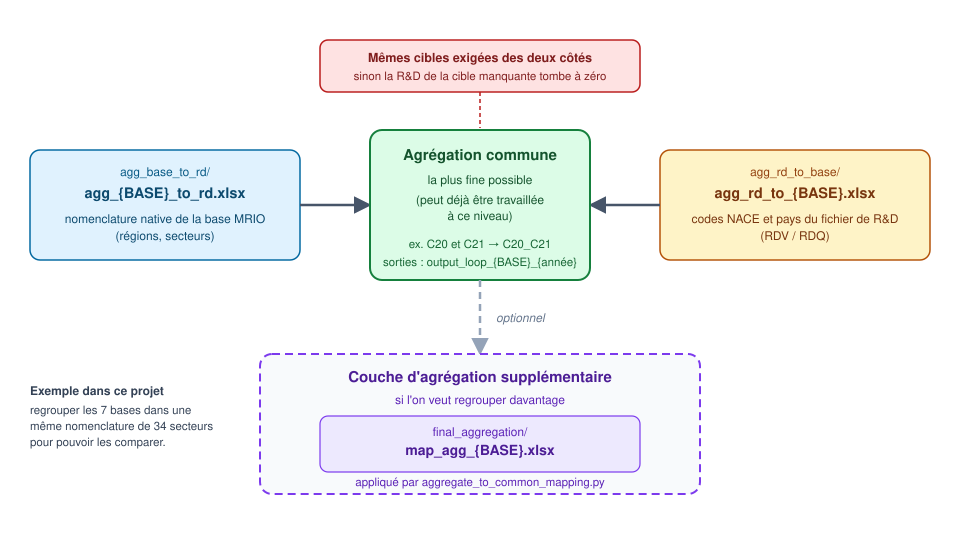

# ENTICE T3.4

Ce dépôt calcule le contenu en R&D (directe, incorporée, importée) porté par les flux d'échanges internationaux, à partir de bases MRIO (EXIOBASE, FIGARO, OECD_ICIO, GTAP) et de trois canaux de diffusion additionnels (CAPITAL, FDI, citations de brevets). Il peut être lancé **sans dimension technologique** (R&D par pays × secteur, noté `(c,s)`) ou **avec** (R&D par pays × secteur × technologie, noté `(c,s,t)`).

- le programme principal : [`code/know_calc_loop.ipynb`](code/know_calc_loop.ipynb)
- les réglages : variables en tête de chaque programme (section 2)
- les fichiers de mapping : [`mapping/`](mapping)
- les fichiers de R&D (racine du projet) : `RDQ_(c,s).csv`, `RDV_(c,s).csv`, `RDQ_(c,s,t).csv`, `RDV_(c,s,t).csv`
- les résultats : `SRDV_(c,s)`, `SRDQ_(c,s)`, `SRDV_(c,s,t)`, `SRDQ_(c,s,t)`
- deux programmes facultatifs, décrits à la fin (section 5) : l'agrégation commune et les graphiques

## 1. Installation

**1. Adapter la version de Python dans le `Pipfile`.** Vérifier la version installée sur l'ordinateur (`py --version`), puis, dans la section `[requires]` du fichier `Pipfile`, y mettre cette version et supprimer la ligne `python_full_version`. Python 3.12 ou 3.13 convient (le projet a été testé en 3.13). Exemple pour Python 3.12 :

```
[requires]
python_version = "3.12"
```

**2. Ouvrir le terminal de l'ordinateur** (invite de commandes sous Windows) et aller dans le dossier du projet :

```
cd "C:\chemin\vers\ENTICE T3.4"
```

**3. Installer `pipenv` puis l'environnement virtuel avec les bonnes versions de paquets :**

```
pip install pipenv
py -m pipenv sync
```

Dans PyCharm, choisir ensuite l'interpréteur de cet environnement (son chemin s'obtient avec `py -m pipenv --venv`), puis redémarrer le noyau du notebook.

## 2. Configuration

Il n'y a pas de fichier de réglages commun : **les variables sont définies au début de chaque programme** (première cellule des notebooks, début du script `.py`). Quand on lance plusieurs programmes à la suite, il faut y mettre les **mêmes valeurs**, sinon les programmes facultatifs (section 5) ne retrouvent pas les résultats du programme principal.

| Variable | Où | Rôle |
|---|---|---|
| `PATH_WRK` | les trois programmes | chemin du projet, à adapter en premier sur chaque ordinateur |
| `BASE` | les trois programmes | base à traiter |
| `YEARS` | les trois programmes | années à calculer |
| `RD_UNIT`, `DIMENSION` | les trois programmes | unité et dimension de la R&D |
| `TECHS` | programme principal, agrégation commune | technologies traitées en mode `(c,s,t)` |
| `TECH` | graphiques | la technologie tracée (une seule) |
| `METRIC_WANTED` | graphiques | `"dir"` ou `"embod"` |
| `METRICS_WANTED` | programme principal | métriques calculées (`"ALL"` = toutes celles de la base) |
| `VERSION_EXIO` | programme principal | version d'EXIOBASE téléchargée |

Détail des variables communes :

- `BASE` : `"EXIOBASE"`, `"FIGARO"`, `"OECD_ICIO"`, `"GTAP"`, `"CAPITAL"`, `"FDI"` ou `"Patents_Citation"`. Une exécution ne traite qu'une seule base : pour en traiter une autre, changer `BASE` et relancer.
- `YEARS` : liste des années à calculer. En mode `(c,s,t)`, elle est limitée automatiquement à 2000–2021.
- `RD_UNIT` : `"value"` (fichiers `RDV`, euros courants, stocks notés `SRDV`) ou `"volume"` (fichiers `RDQ`, euros constants 2020, stocks notés `SRDQ`).
- `DIMENSION` : `"(c,s)"` (sans technologie) ou `"(c,s,t)"` (avec technologie).
- `TECHS` : technologies calculées en mode `(c,s,t)`, par exemple `["TJ11", "TJ07", "TJ01"]` (`"TG*"` = tous les codes qui commencent par TG). Trois technologies environ sont conseillées : chacune est une passe complète de calcul.

## 3. Le programme principal : `know_calc_loop.ipynb`

### 3.1 Ce qu'il fait et comment le lancer

Pour chaque année de `YEARS`, il télécharge (si besoin) et parse la base MRIO, l'agrège avec `mapping/agg_base_to_rd/agg_{BASE}_to_rd.xlsx`, calcule les exports, importations et la production, construit le stock de R&D (inventaire permanent, dépréciation de 15 %) mappé avec `mapping/agg_rd_to_base/agg_rd_to_{BASE}.xlsx`, puis calcule les métriques ci-dessous et les écrit en CSV. En mode `(c,s,t)`, le stock et les métriques sont refaits pour chaque technologie, alors que le parsing de la base n'est fait qu'une fois par année.

Pour le lancer :
1. ouvrir `code/know_calc_loop.ipynb` et régler les variables de la première cellule (section 2) ;
2. vérifier que les données d'entrée de la base choisie sont en place (3.2) ;
3. exécuter les cellules dans l'ordre.

GTAP charge des fichiers très lourds et peut dépasser la mémoire (`MemoryError`) : fermer les autres programmes, redémarrer le noyau, et ne traiter qu'une base à la fois.

| Base | Métriques calculées | Canal |
|---|---|---|
| EXIOBASE, FIGARO, OECD_ICIO, GTAP | `rd_dir_CI`, `rd_embod_CI`, `rd_imp_CI` | flux d'échanges intermédiaires |
| CAPITAL | `rd_dir_CAPITAL`, `rd_embod_CAPITAL` | stock de capital fixe (Kbar) |
| FDI | `rd_dir_fdips` | investissements directs étrangers |
| Patents_Citation | `rd_dir_cit` | citations de brevets |

`rd_dir` est la R&D directe (premier niveau, sans propagation dans la chaîne de production) ; `rd_embod` est la R&D totale incorporée (`rd_dir` propagée par l'inverse de Leontief) ; `rd_imp` est `rd_embod` restreinte aux flux transfrontaliers.

### 3.2 Données d'entrée

**R&D** (racine du projet), choisie par `RD_UNIT` et `DIMENSION` :

| `RD_UNIT` | `DIMENSION` | Fichier | Contenu |
|---|---|---|---|
| `volume` | `(c,s)` | `RDQ_(c,s).csv` | `year;country_code;nace_code;rd_value_volume_M€`, séparateur `;`, 1995–2022, euros constants 2020 |
| `value` | `(c,s)` | `RDV_(c,s).csv` | `year,country_code,nace_code,rd_value_M€`, séparateur `,`, 1995–2022, euros courants |
| `volume` / `value` | `(c,s,t)` | `RDQ_(c,s,t).csv` / `RDV_(c,s,t).csv` | format large, colonne `VAR` = `RDQ_<pays>_<secteur>_<technologie>_<groupe>`, une colonne par année 2000–2021 |

Les fichiers `(c,s,t)` ne couvrent que l'industrie manufacturière (et `J62_J63`) : les autres secteurs ont une R&D technologique nulle. Les volumes de quelques pays (BR, IN, RU, RO, MX…) y semblent déflatés autrement que dans `(c,s)` : à utiliser avec prudence.

**Bases MRIO et canaux** (dossier `data_raw/`) :

| Base | Récupération | Emplacement attendu |
|---|---|---|
| EXIOBASE | automatique | `data_raw/data_EXIOBASE/` (temporaire) ; version fixée par `VERSION_EXIO` dans le notebook |
| FIGARO | automatique | `data_raw/data_FIGARO/` (temporaire) |
| OECD_ICIO | **manuelle** | `data_raw/data_OECD_ICIO/2016-2022_EXT/{année}.csv` |
| GTAP | **manuelle** | `data_raw/V12APOW/V12APOW_MRIO_{période}/` (périodes 2004, 2007, 2011, 2014, 2017, 2019, 2023 ; chaque année prend la période la plus proche) |
| CAPITAL | EXIOBASE (auto) + Kbar **manuel** | `data_raw/all_kbar/Kbar_exio_v3_8_2_{année}_cfc_pxi.mat` |
| FDI | **manuelle** | `data_raw/data_FDI/fdi_158_65.har` |
| Patents_Citation | **manuelle** | `data_raw/data_Patents_Citation/Fractional_Citations_..._prefiltered.csv` |

### 3.3 Sorties

Les résultats vont dans `<OUTPUT_ROOT>/<BASE>/` (`SRDV_(c,s)`, `SRDQ_(c,s)`…). En mode `(c,s,t)`, un sous-dossier par technologie s'intercale : `SRDV_(c,s,t)/<technologie>/<BASE>/`.
- `output_loop_{BASE}_{année}/` : un CSV par métrique (par exemple `rd_dir_CI_{BASE}_{année}.csv`), matrice carrée `(Region, Level, Item)`, séparateur `;`, à la résolution sectorielle de la base.
- `output_loop_{BASE}/` : fichiers toutes années en colonnes, `exports_`, `imports_intermediate_`, `imports_final_demand_` et `production_{BASE}.csv` (EXIOBASE, FIGARO, OECD_ICIO, GTAP, CAPITAL seulement).

## 4. Les mappings (`mapping/`)



La base MRIO (à gauche) et le fichier de R&D (à droite) sont chacun ramenés par un premier mapping à une même **agrégation commune**, la plus fine possible (au milieu). C'est à ce niveau que les deux côtés doivent avoir exactement les mêmes cibles, et il fixe la résolution des résultats. Une **couche d'agrégation supplémentaire** est facultative (section 5.1).

| Fichier | Rôle |
|---|---|
| `agg_base_to_rd/agg_{BASE}_to_rd.xlsx` | passe la base de sa nomenclature native à la nomenclature de travail (lu par `mario`) ; feuilles `Sector` (`sector_name (BASE)` → `nace_code (aggregated)`) et `Region` (`region_code (BASE)` → `country_code (aggregated)`) ; `mario` lit la 1ʳᵉ colonne comme source et la 2ᵉ comme cible, quel que soit leur titre |
| `agg_rd_to_base/agg_rd_to_{BASE}.xlsx` | passe les 56 codes NACE et les pays du fichier de R&D à la **même** nomenclature de travail ; feuilles `Sector` (`nace_code (RD)` → `nace_code (aggregated)`) et `Region` (`country_code (RD)` → `country_code (aggregated)`) |
| `final_aggregation/map_agg_{BASE}.xlsx` | facultatif : passe la nomenclature de travail aux 34 secteurs communs aux 7 bases (section 5.1) |

Le programme principal trouve ces fichiers grâce aux dictionnaires `AGG_FILES` et `MAP_RD_FILES` de la première cellule de `know_calc_loop.ipynb`. Les autres fichiers de `mapping/` (GTAP avant et après 2007, FDI, citations, Kbar de CAPITAL, `Mapping_Ind_prod.xlsx`, `map_capital_iso.xlsx`) sont propres à une base et lus par le même notebook.

**La règle à respecter :** pour une base, les **secteurs** cibles de `agg_{BASE}_to_rd.xlsx` et de `agg_rd_to_{BASE}.xlsx` doivent être strictement identiques. Une cible présente d'un côté seulement fait tomber la R&D correspondante à zéro, sans avertissement. Pour les régions, le fichier de R&D peut en avoir plus que la base (leur R&D est perdue), mais une région de la base absente du fichier de R&D n'aura aucune R&D.

**Créer ou mettre à jour les mappings d'une base :**
1. lister les régions et secteurs natifs de la base (par exemple en parsant la base avec `mario`) et les codes NACE du fichier de R&D ;
2. dans `agg_{BASE}_to_rd.xlsx` (copier un fichier existant comme modèle), remplir la colonne `nace_code (aggregated)` de la feuille `Sector` et `country_code (aggregated)` de la feuille `Region` : l'agrégation doit être la plus fine possible commune aux deux nomenclatures ;
3. dans `agg_rd_to_{BASE}.xlsx`, remplir `nace_code (aggregated)` et `country_code (aggregated)` pour chaque code NACE et chaque pays du fichier de R&D, avec **exactement les mêmes libellés de cible** qu'à l'étape 2 (les pays absents de la base vont dans `RW`) ;
4. déclarer le fichier dans `AGG_FILES` et `MAP_RD_FILES` du programme principal si son nom a changé ou si la base est nouvelle.

## 5. Programmes facultatifs

Ces deux programmes ne sont pas nécessaires au calcul : ils exploitent les résultats du programme principal.

### 5.1 Agrégation commune : `code/aggregate_to_common_mapping.py`

Regroupe les matrices produites par le programme principal sur une nomenclature de secteurs commune aux 7 bases (34 secteurs), avec `mapping/final_aggregation/map_agg_{BASE}.xlsx`, pour pouvoir comparer les bases entre elles. Chaque résultat est écrit à côté du fichier d'origine avec le suffixe `_agg` (par exemple `rd_dir_CI_EXIOBASE_2015_agg.csv`) ; rien n'est écrasé. Comme les matrices sont déjà pondérées par l'intensité de R&D, sommer des lignes ou des colonnes ne crée aucun biais. À lancer après le programme principal, avec les mêmes `BASE`, `RD_UNIT`, `DIMENSION` et `TECHS` réglés en tête du script :

```
py -m pipenv run python code/aggregate_to_common_mapping.py
```

### 5.2 Graphiques : `code/graphs_output_general.ipynb`

Trace des diagrammes de flux (Sankey) et des décompositions d'origine à partir des matrices de sortie. Il parcourt tous les *runs* disponibles (valeur ou volume, avec ou sans technologie) et affiche leur catalogue au démarrage. Il utilise par défaut le run défini par `RD_UNIT`, `DIMENSION` et `TECH` en tête du notebook ; pour en tracer un autre, modifier ces variables ou `DEFAULT_RUN` :

```python
DEFAULT_RUN = run_id("volume", "(c,s,t)", "TJ07")   # volume, technologie TJ07
```

Pour comparer plusieurs runs sur un même graphique, ajouter le run comme 4ᵉ élément de chaque source de `plot_origin_decomposition_panels`, par exemple `("EXIOBASE", "rd_dir_CI", 2010, run_id("value", "(c,s)"))`. `USE_AGG = True` lit les fichiers `_agg` au lieu des matrices à la résolution de chaque base. Les figures sont écrites dans `runs/<run>/graphs_output_loop/` (ou `runs/comparison/graphs_output_loop/` pour une comparaison).
